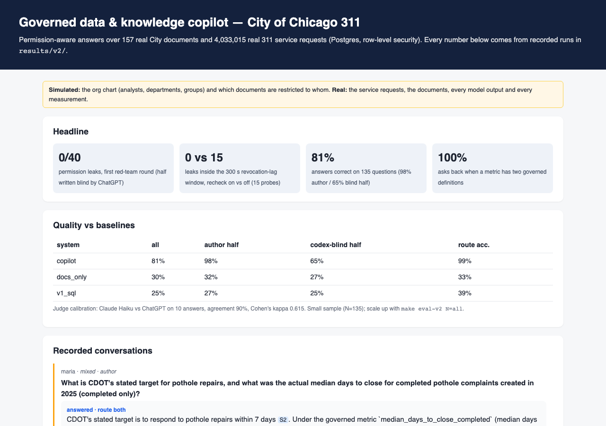
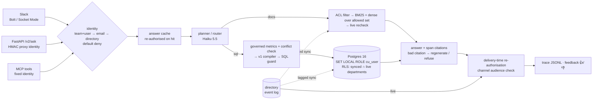
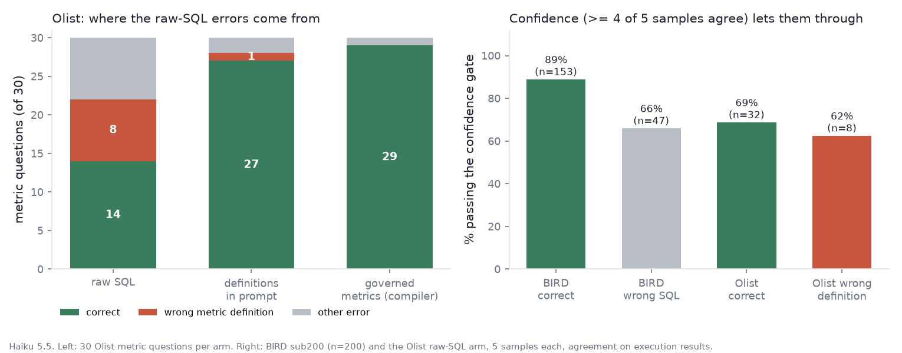
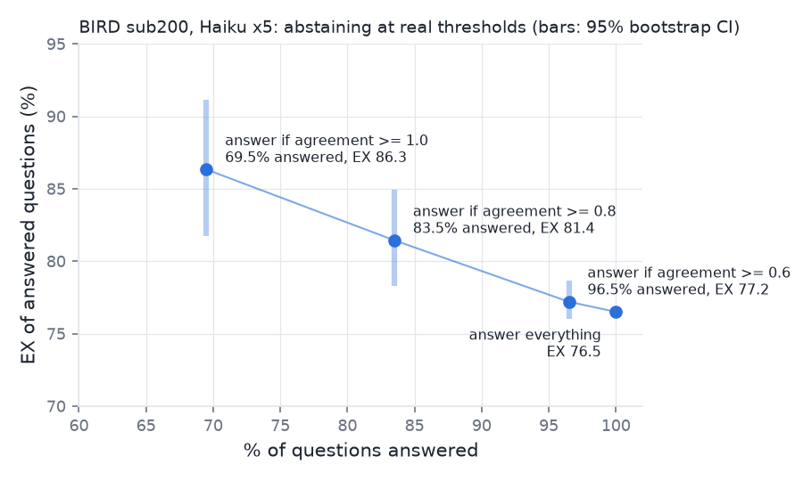

# analytics-agent v2: a permission-aware data and knowledge copilot for City of Chicago 311

[](https://github.com/TonyLee-99/analytics-agent/actions/workflows/ci.yml)
  

**A Slack copilot over 4.0M real Chicago 311 requests and 157 City documents that showed nobody data they may not see: 0 leaks across a 60-attack red team (20 written blind after the fixes), while the same checker finds 8 of 10 revocation scenarios leaking with the defences switched off; 81% of 135 questions answered correctly vs 30% for docs-only RAG.**



| | |
|---|---|
| **Business problem** | City department analysts ask Slack for "what does the city say about X" and "what are the numbers for Y". Documents and warehouse rows are restricted by department, people change teams all the time, and two departments define "time to close" differently. A copilot is only usable if nobody ever sees what they may not, and the numbers use the right definition. |
| **What I built** | Ingest (4,033,015 real 311 requests into Postgres 16, 157 real City documents, polite fetcher) → index with ACLs (BM25 + local bge-small embeddings) → permission-aware retrieval (filter before ranking, live recheck) and SQL under each user's own Postgres role with row-level security → planner/router + v1's governed metric compiler with conflict detection → answer with span citations, re-authorised at delivery → Slack bot (Bolt; emulator for tests) + MCP + FastAPI → per-answer traces → eval gate in CI → static demo page. |
| **Measured results** | Red team: 0/40 leaks in round 1, 0/60 after the fixes, including 0/20 for a fresh batch written blind after the fixes; with the defences switched off the same oracle finds 8/10 revocation scenarios leaking. Lag window: 0 leaks with recheck vs 15/15 without. Answers on all 135 questions: 81% (98% author half, 65% codex-blind half, 73% blind holdout) vs 30% docs-only RAG and 25% for the v1 SQL agent; router 99%, recall@5 100%; asks back on 100% of ambiguous metric questions and on 0% of questions that already state the definition. Judge vs second grader: kappa 0.615 on 10. |

**Simulated vs real.** Real: the 311 service requests (City of Chicago Data Portal, via the read-only
[chicago-311-warehouse](https://github.com/TonyLee-99/chicago-311-warehouse) build), the documents (chicago.gov and
data-portal metadata, `corpus/`), every model output, every number. **Simulated**: the org chart
(`config/org.yaml`), which documents are restricted to whom (`config/doc_acl.yaml`), metric-definition ownership,
the discovery notes. The Slack path was run against a local emulator with the real Bolt app; the live Socket
Mode path needs a Slack app (owner account).

## Architecture

Design and the independent review that changed it: [docs/DESIGN.md](docs/DESIGN.md). Decisions:
[docs/decisions/](docs/decisions/). Incidents and a postmortem: [docs/INCIDENTS.md](docs/INCIDENTS.md).

## Run it
Offline (no model calls, replays recorded responses; Postgres tests need a local Postgres):
```bash
make init        # pinned deps + unpack committed replay caches
make pg-start pg-load   # local Postgres 16 + the 311 window (needs a built chicago-311-warehouse; path in AA_311_SOURCE) + RLS
make check       # lint, v1 + v2 tests (permission tests on real Postgres), eval gate
```
Live: `make eval-v2 N=15` (Claude Haiku 5.5 through the Claude Code CLI), `make redteam-v2`, `make lag-experiment`,
`make site`. Slack: `SLACK_BOT_TOKEN=... SLACK_APP_TOKEN=... uv run python -m analytics_agent.copilot.slack_app`.

## Results (`results/v2/`, details in [docs/EVAL.md](docs/EVAL.md))
All 135 questions (`make eval-v2 N=all`): 60 author-written, 60 written blind by codex, 15 more written blind by codex
after the fixes (holdout).

| correct | copilot | docs-only RAG | v1 SQL agent |
|---|---|---|---|
| all 135 | **81%** (CI 73–87%) | 30% | 25% |
| author half (60; used for development) | 98% | 32% | 27% |
| codex-blind half (60) | 65% | 27% | 25% |
| codex-blind holdout (15, written after the fixes) | 73% | 33% | 20% |
| router accuracy | 99% | — | — |

| Permission test | Result |
|---|---|
| red team round 1 (20 author + 20 codex-blind) | 0/40 leaks |
| same oracle, defences off, 10 revocation scenarios | 8/10 leak |
| red team after the fixes (the 40 + 20 new blind holdout attacks) | 0/60 leaks (holdout 0/20) |
| revocation-lag window, recheck on / off | 0 / 15/15 leaks |
| RLS vs policy-model oracle, 10 users x 5 probes, guard bypassed | exact match |
| Postgres copy vs source, per department | 4,033,015 rows, 0 mismatches |

**What did not work / limits.**
- The blind halves are much harder than the author half (65% vs 98%; the author half was used for development).
  Most blind misses are SQL shape: the right figure without the helper columns asked for, or a different row
  breakdown (strict SQL 42% on the codex half; codex-half accuracy is 75% when only the key value of each SQL answer is checked).
- 3 of 9 questions that state a metric definition return the right figure in the wrong shape.
- The red team missed two delivery leaks that the independent acceptance review found (channel members past the
  first page; a revocation during the member lookup). Both fixed with tests (docs/INCIDENTS.md I-4, I-5).
- Judge calibration is 10 answers only.
- The v1 baseline is a historical reference (no permissions, no documents), not a fair rival.
- Over-denial: after the recheck drops restricted chunks, some in-scope sub-questions get "no sources".

## From demo to production
Identity from the IdP (SCIM) instead of `org.yaml`; documents from the real change feed (Drive/SharePoint)
with the same event model; managed Postgres with scram/TLS and the gateway credential in a secret store;
sync-lag SLO and leak-oracle alerts (docs/RUNBOOK.md); phased rollout with kill switches (docs/ROLLOUT.md).
Product and platform lessons: docs/FEEDBACK_TO_PRODUCT.md. PRD: docs/PRD.md.

## How the results were checked
Checks the code under test does not control: an independent design review before coding; half of the
questions and half of the attacks written blind by a different model (ChatGPT via codex) from the corpus,
schema and org chart only; gold answers are executed SQL; the leak oracle is mechanical and was itself
validated by switching the defences off; database-layer tests run with the SQL guard bypassed.

---

# v1 (unchanged): confidence catches SQL mistakes, not definition mistakes

| | |
|---|---|
| **Problem** | Text-to-SQL assistants let anyone ask the warehouse a question, but a confidently wrong number in an exec deck is worse than no answer. The hard part is knowing when to trust the answer. |
| **What I built** | An analytics agent (retrieve → plan → generate → validate → execute → self-correct) with read-only SQL guardrails, PII pseudonymization and resource limits; self-consistency confidence with abstention; a governed metric layer and SQL compiler; an evaluation harness on the BIRD Mini-Dev benchmark; a red-team suite; a prompt regression gate; FastAPI and MCP serving. |
| **Key results** | Execution accuracy 62.6% → 73.2% on 500 BIRD questions (paired McNemar p < 0.001). Business-metric questions 14/30 → 27/30 with governed definitions, 29/30 when the metric is compiled. 86.3% accuracy at 69.5% coverage when answering only confident questions. 64/64 attacks blocked with 0 false positives on 550 valid queries. |
| **Stack** | Python, SQL (SQLite, DuckDB), sqlglot, Claude Haiku / Sonnet, FastAPI, MCP, pytest, GitHub Actions |

A text-to-SQL analytics agent ("ask your data warehouse") with a governed metric layer, evaluated for
one question: **when can you trust its number?**

- **Definition errors look like confident answers.** On 30 business-metric questions over the Olist
  warehouse, the raw-SQL agent silently used a *non-governed* definition on 8/30: GMV with freight,
  canceled orders counted, AOV from payments. Its own confidence signal (agreement of 5 samples on the
  result) passed 5 of 8 of those wrong answers at a ≥4/5 gate.
- **Definitions fix it; a compiler makes it structural.** Putting the governed definitions in the
  prompt takes metric questions from 14/30 to 27/30 (p=0.001). Compiling governed metrics to SQL
  gives 29/30 with zero drift. Compiler vs prompt is not significant at this n (p=0.5).
- **Confidence does catch SQL errors.** On BIRD, answering only when all 5 samples agree covers
  69.5% of questions at 86.3% EX, against 76.5% when answering everything (gain +5.2 to +14.6 pp,
  95% bootstrap CI).



**What did not work** (pre-registered criteria, `docs/v1/ACCEPTANCE.md`):
- The confidence score ranks right vs wrong with AUROC 0.69 (CI 0.61–0.77): *inconclusive* against
  the 0.70 target.
- The agent asks a clarifying question on only 60% of genuinely ambiguous questions (target 70%).
- The Haiku→Sonnet router misses its accuracy target.
- Self-correction is not significant run-vs-run.
- Red-teaming also found three security holes after the first version shipped (§4).

## 1. Business definitions: raw SQL vs a governed metric layer (Olist, Haiku 5.5)
The same 50 PM-style questions, the same model, and 2 self-correction rounds in every arm.
30 questions depend on a governed metric such as GMV, AOV or on-time rate; 20 do not.

| Arm | Metric questions correct | Wrong-definition answers | All 50 | Paired test |
|---|---|---|---|---|
| raw SQL (schema + column docs) | 14/30 | 8/30 | 64.0% | |
| + governed definitions in the prompt | 27/30 | 1/30 | **90.0%** | vs raw: +14/−1, p=0.001 |
| governed metrics → compiler writes the SQL | 29/30 | 0/30 | 80.0% | vs prompt: +2/−0, p=0.5 |
| hybrid: compiler for metric questions, prompt arm for the rest (*post hoc*) | 29/30 | 0/30 | 94.0% | vs prompt: +2/−0, p=0.5 |

**Caveats.**
- The definitions, the gold SQL and the compiler were all written for this repo. The raw arm is scored against
  conventions it was never shown; that is the business problem, but it makes 46.7% a "didn't guess
  our conventions" number, not a SQL-skill number.
- n=30 metric questions.
- The compiler arm's weak non-metric score (55%) is its fallback prompt, which over-applied metric
  filters. The hybrid was designed after reading those failures.

Details: `docs/v1/semantic_layer_experiment.md`. Numbers: `results/stats.json` (`semantic`).

## 2. Knowing when not to answer (BIRD sub200, Haiku, 5 samples)
| Policy | Answered | EX of answered |
|---|---|---|
| answer everything (vote of 5) | 100% | 76.5% |
| answer if ≥ 4 of 5 agree | 83.5% | 81.4% |
| answer if all 5 agree | 69.5% | 86.3% |



- **Agreement is a coarse score.** It takes 5 values, and 139 of 200 answers are unanimous, so EX at
  an arbitrary coverage such as "80%" depends on how ties are broken. That is why only the achievable
  thresholds are reported.
- **Routing to Sonnet when Haiku is unsure** (explicit price sheet, no prompt caching):
  - escalating at agreement < 0.8, the pre-registered threshold, gives 82.0% EX at 53% of
    Sonnet-only cost;
  - escalating unless unanimous gives 84.5% at 67% of the cost;
  - Sonnet alone gives 86.0%;
  - an oracle that escalates exactly Haiku's wrong answers would reach 91.5%.
- **Learned policy.** A router learned with nested CV, with an explicit cost per wrong answer, does
  not beat these simple rules.
  - At $1 per wrong answer it reaches 85.3% EX, about the same expected cost as always using Sonnet.
  - Its out-of-fold AUROC is 0.65, below agreement alone.
  - The bottleneck is the selection signal: some sample among the 5 is correct 87.4% of the time.
  - Source: `results/learned_router.json`.
- **Serving.** The API returns this same confidence. `route` is one of answered, needs_review,
  escalated, clarify or failed, and the review threshold is unanimity (`serving/service.py`).
- **Ambiguity.** On 20 curated ambiguous questions, the raw agent asks back 60% of the time and the
  metric-layer agent only 35%: it answers with the governed default instead. There were 0 false
  clarifications on 20 clear controls.

## 3. BIRD Mini-Dev benchmark (2026 release, 500 questions, SQLite)
| Haiku 5.5 | EX, all 500 | EX, excluding the 20 prompt-dev questions |
|---|---|---|
| (a) BIRD's fixed baseline prompt, zero-shot | 62.6% | 63.1 |
| (d) our prompt + retrieved examples + self-correction | 73.2% | 72.9 |

- **Sanity check, not a reproduction.**
  - The dataset card reports 59.60% for Haiku 5.5 with the fixed prompt
    (`eval_sets/provenance/`, revision `5b256b5`, same data files as ours).
  - Our run deviates in three ways: we add a one-line system prompt, the CLI's default temperature
    applies instead of greedy decoding, and we use our own SQL extraction.
  - +3.0 pp is within the ±3.2 pp noise of a single 500-question run.
- **Noise floor.** Two independent draws of the same prompt disagree on 13.5% of questions. A
  run-vs-run delta therefore needs to exceed about ±3.2 pp on 500 questions, or ±5.1 pp on the
  200-question subset, to mean anything.
- **The subset is easier by chance.** The baseline scores 69.5 on sub200 vs 58.0 on the other 300
  (z = 2.7). Use the subset for paired comparisons only.
- **What actually helped** (paired tests on the same questions; `results/ablations.md`):
  - the plan-first prompt: +7.0 pp on sub200, p = 0.08;
  - retrieved examples, only when a near-template exists: no effect on the 391 questions whose
    closest example is dissimilar (SQL Jaccard < 0.5); +10/−2 on the 74 near-templates;
  - self-correction, fixed 9 of 14 broken first drafts: exactly +1.8 pp within one run;
  - Sonnet: +11.5 pp.
- **What did not help.**
  - Schema retrieval *hurt* slightly (76.5 → 72.0, p = 0.12), because BIRD databases have only 3–13
    tables. Recall@10 in an 84-table pooled index is 0.946 (`results/retrieval_recall.json`).
  - The 5-sample vote adds +1.0 pp over its own first sample.
- **Robustness.** Every comparison above was re-scored four ways (official set equality, multiset,
  ordered, float tolerance) and under simulated label noise drawn from a 70-failure audit.
  - No conclusion changes with the metric: same signs, same significance.
  - Under label noise, the three significant results stay significant in 88–100% of simulated
    draws. The least robust is (a)→(b), at 88% under independent noise.
  - Details: `results/robustness.json`, `docs/v1/error_analysis.md`.

## 4. Safety (`docs/v1/security.md`)
The defence has an AST validator, read-only connections with an SQLite authorizer and DuckDB config
lock, masked materialized tables, and time/row/byte limits. Each layer is tested with the layers above
it switched off. Five holes were found and fixed:
- two in v1's own bypass test: SQLite `ATTACH` creating files, and raw PII readable behind masking views;
- three in external review:
  - md5 zip tokens a single SELECT inverted for all 99,441 customers; now keyed HMAC;
  - an allowlist bypass by naming a CTE `sqlite_master`; now scope-aware resolution;
  - unbounded-memory queries; now byte and size limits.

All 64/64 red-team attacks are now blocked, with 0/550 false positives on gold queries and 0 of the
agent's previously correct recorded queries rejected.

## Reproduce v1
```bash
make setup               # Python 3.12, pinned deps (uv.lock)
make unpack              # restore the recorded runs + LLM response cache (committed, compressed)
make reproduce-results   # rebuild results/*.json and charts with zero model calls; fails on any cache miss
make data verify-data    # download BIRD + Olist and build the warehouse (needed for re-executing SQL)
make test lint           # unit tests; DB-dependent tests skip without `make data`
make eval-small          # 20 live questions (Haiku via the Claude Code CLI)
```
- **Data:** [BIRD Mini-Dev](https://huggingface.co/datasets/birdsql/bird_mini_dev) (CC BY-SA 4.0) and [Olist](https://www.kaggle.com/datasets/olistbr/brazilian-ecommerce) (CC BY-NC-SA 4.0, 99,441 orders, row counts verified). The Olist question sets are in `eval_sets/`. Code is MIT-licensed ([LICENSE](LICENSE)); data and derived files keep their source licenses.
- **CI:** a workflow is included (`.github/workflows/ci.yml`: lint, tests, regression gate on recorded responses) runs on every push.
- **Regression gate:** a prompt change fails if it loses ≥5 more of 30 frozen questions than it gains. False-alarm rate 2.1%; it flags the recorded degraded prompt; it catches a true −5 pp regression only 10% of the time at n=30 (`tests/regression/gate.json`).

## Cost
3,397 Claude calls, $10.84 at API list price as reported by the CLI (`total_cost_usd`), all evaluation included.

## Limitations
- BIRD schemas are tiny next to a warehouse; the 84-table pooled index is only a proxy (no column pruning, no LLM re-ranker).
- One draw per configuration at the CLI's default temperature, so single-run deltas carry the noise above.
- 10 of 200 self-consistency prompts predate a determinism fix and do not replay byte-identically; reported numbers come from the recorded run files.
- The Olist question sets, definitions and gold SQL were written for this repo (every query executed); the ambiguity set has n=20.
- Latency includes CLI process start-up, so it is not a headline. Production mapping: `docs/v1/production_readiness.md`.
