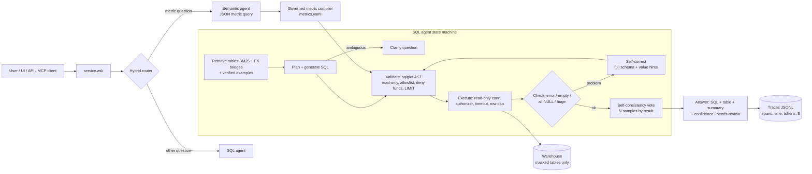
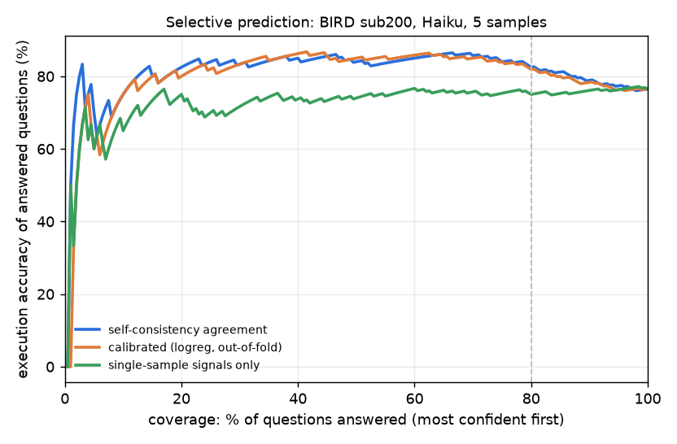
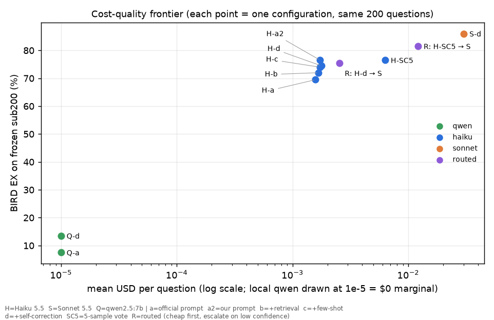

# analytics-agent: "ask your data warehouse", built and evaluated like a production AI feature

A text-to-SQL analytics agent in the spirit of Uber's QueryGPT, LinkedIn's SQL Bot and Pinterest's
text-to-SQL. The agent itself is the easy part. This repo focuses on what decides whether such a
system can be trusted with business numbers:

1. **Knowing when not to answer.** The agent attaches a confidence to every answer, abstains on low
   confidence, and asks a clarifying question when a question is genuinely ambiguous. Each of these
   is measured.
2. **Grounding in a governed semantic layer.** A controlled experiment compares raw SQL, raw SQL plus
   the metric definitions as text, governed metrics compiled to SQL, and a hybrid of the two.
3. **Evaluation a real AI team would accept.**
   - Official-style execution accuracy on BIRD Mini-Dev (2026 release), with a reproduction check
     against the published Haiku number.
   - An ablation chain with paired significance tests.
   - Cost, latency and token accounting from the CLI's own usage fields.
   - A cost–quality frontier and a measured router.
   - Hand-labelled error analysis that quantifies benchmark label noise.
   - A red-team suite that tests every safety layer with the layer above it switched off.
4. **Evals as CI.** A frozen regression set with recorded LLM responses and an accuracy gate, which
   provably fails a degraded prompt.

Every number below comes from a file in `results/`, produced by the command named next to it. All
data is public and real: no number is synthetic.

## The business problem
At large companies, PMs and ops leads wait days for simple data pulls because the analytics queue is
the bottleneck. Uber, for example, reports about 1.2M interactive queries a month on its data
platform; QueryGPT targets ~3 minutes per query instead of ~10 minutes of hand authoring [1].
The real risk is not slowness. It is a **confident wrong number in an executive deck**. So the
success criteria here are accuracy *and* calibrated abstention *and* consistency of business
definitions *and* safety, at a known cost per question.

## Architecture



- The LLM sits behind one `LLMClient` interface with these backends:
  - **Claude through the headless Claude Code CLI.** Each call strips the CLI's own system prompt,
    tools, MCP servers and settings, and logs `usage` and `total_cost_usd`.
  - **Ollama qwen2.5:7b**, for a local, "data never leaves" deployment.
  - **Mock / cassette replay**, for tests and CI.
- Swapping the CLI for an API key is a one-class change.
- Every response is cached on disk by prompt hash, so every eval re-run is free.
- A ledger enforces a hard call budget mechanically.
- **No agent framework.** The agent is an explicit ~40-line state machine (`agent.py`). LangGraph
  earns its keep with many cooperating agents and resumable human-in-the-loop UI states (LinkedIn's
  SQL Bot uses it for that). For one loop with a retry edge, plain code is easier to test, trace and
  review.

## Data (real, public)
| Data | What | Source / license |
|---|---|---|
| BIRD Mini-Dev, 2026 "Mini-Dev 1024" release (SQLite) | 500 questions on 11 real databases with gold SQL, evidence hints and difficulty labels (460 challenging / 32 moderate / 8 simple in this release) | [HF birdsql/bird_mini_dev](https://huggingface.co/datasets/birdsql/bird_mini_dev), DBs from [bird-bench/mini_dev](https://github.com/bird-bench/mini_dev), CC BY-SA 4.0 |
| BIRD dev (full, 1,534 pairs) | few-shot "verified query log" on the *same* 11 DBs, decontaminated against the 500 test questions (1,009 kept) | [bird-bench.github.io](https://bird-bench.github.io/), CC BY-SA 4.0 |
| Olist Brazilian e-commerce | 99,441 orders, 9 tables (row counts verified exactly), loaded into DuckDB with PII-masked materialized tables | [Kaggle olistbr/brazilian-ecommerce](https://www.kaggle.com/datasets/olistbr/brazilian-ecommerce) via HF mirror `aviahYadler/Olist_Ecommerce_Dataset` (SHA-256 matches a second mirror), CC BY-NC-SA 4.0 |
| Olist golden set (this repo) | 50 PM/ops questions with executed gold SQL, 65 executed "plausible wrong definition" variants, 4 paraphrase groups; 20 ambiguous questions with ≥2 executed interpretations each; 20 clear controls | `eval_sets/` |

## How to run
```bash
make setup              # uv venv, Python 3.12, pinned deps (uv.lock)
make data               # download BIRD + Olist, build DuckDB warehouse (+ red-team copy)
make verify-data        # every gold query runs (500 BIRD, 50+65+52+20 Olist)
make test lint          # 115 tests, ruff
make eval-small         # 20 BIRD questions, full pipeline (Haiku)
make eval-full          # the BIRD ablation chain + Sonnet + self-consistency (cached after first run)
make semantic ambiguity abstention routing frontier redteam traces report
uv run uvicorn analytics_agent.serving.api:app --port 8000   # chat UI at http://localhost:8000
uv run python -m analytics_agent.serving.mcp_server          # MCP server (stdio)
```

## Results

### 1. BIRD Mini-Dev, 2026 release, 500 questions, SQLite (`make eval-full` → `results/ablations.md`)
EX is BIRD's execution accuracy: the set of result rows equals gold, as in the official
`evaluation_ex.py`. Cost is the CLI's own `total_cost_usd`. Latency is modeled end-to-end: LLM call
latencies on the critical path plus DB time.

| Claude Haiku 5.5, all 500 questions | EX | 95% CI | vs previous (paired McNemar) | $/question | p95 latency |
|---|---|---|---|---|---|
| (a) BIRD's **official fixed prompt**, full schema, zero-shot | **62.6%** | 58.3–66.7 | – | 0.0016 | 15.3 s |
| (b) our prompt (plan first) + schema retrieval (BM25 top-6 + FK/lookup expansion) | 69.8% | 65.6–73.7 | +93/−57, p=0.004 | 0.0017 | 17.3 s |
| (c) + 3 retrieved verified examples (decontaminated BIRD-dev "query log") | 71.6% | 67.5–75.4 | +47/−38, p=0.39 | 0.0018 | 16.4 s |
| (d) + execution-guided self-correction (≤2 rounds, value hints) | **73.2%** | 69.2–76.9 | +15/−7, p=0.13 (vs (a): +107/−54, p=4e-5) | 0.0018 | 18.5 s |

- **Reproduction check.** BIRD's published fixed-prompt baseline for Claude Haiku 5.5 on SQLite is
  59.60%. Our run (a) uses the identical prompt, data and metric and scores 62.6%, a gap of +3.0 pp.
  This is a reproduction, not a leaderboard claim; rows (b)–(d) use our own pipeline.
- **Difficulty mix.** The 2026 release has 460 challenging, 32 moderate and 8 simple questions. EX by
  difficulty is in `results/ablations.md`. With n=8, the "simple" column is noise.

**One change at a time, on the frozen stratified 200-question subset** (`results/ablations.md`; exact
McNemar):

| Change (A → B) | EX A → B | B-only right / A-only right | p |
|---|---|---|---|
| our prompt vs official prompt (full schema) | 69.5 → 76.5 | 35 / 21 | 0.08 |
| **schema retrieval vs full schema** (same prompt) | 76.5 → **72.0** | 9 / 18 | 0.12 |
| few-shot examples vs none | 72.0 → 74.0 | 19 / 15 | 0.61 |
| self-correction vs none | 74.0 → 74.5 | 3 / 2 | 1.0 |
| self-consistency ×5 vote vs single answer | 74.5 → 76.5 | 10 / 6 | 0.45 |
| Sonnet 5.5 vs Haiku 5.5 (same pipeline) | 74.5 → **86.0** | 36 / 13 | 0.001 |
| Haiku vs local qwen2.5:7b (same pipeline; qwen official prompt: 7.5%) | 13.5 → 74.5 | 125 / 3 | <1e-6 |

Honest readings:
- **Retrieval does not help on BIRD; it slightly hurts.**
  - Each BIRD database has only 3–13 tables, so the full schema fits in the prompt. Pruning can only
    lose tables: strict all-gold-tables recall@6 is 0.986, at 5.8 of 6.7 tables on average.
  - Retrieval matters at warehouse scale. With all 12 databases pooled into one 84-table index,
    BM25 recall@10 is 0.904; hybrid BM25 + bge-small with reciprocal-rank fusion reaches 0.946, with
    top-1 database routing at 0.993 (`results/retrieval_recall.json`). The agent keeps retrieval for
    that setting, and the self-correction step always sees the full schema.
- **Noise floor.** Four independent draws of the *same* prompt on 190 questions give EX from 70.0% to
  74.2% (std 2.0 pp). 13.5% of questions flip between two draws (`results/noise_floor.json`). Any
  single-run delta under about 4 pp, including several rows above, is within sampling noise. The
  questions above were re-scored by pairs for that reason.
- **Self-correction is small but precise.** It fired on 14 of 500 questions (2.8%) and fixed 9 of
  them: 6 of 7 empty results, 2 of 4 errors, 1 of 3 all-NULL results. That is an exact gain of
  +1.8 pp, measured within one run (`docs/error_analysis.md`).
- **Sonnet comparison.** Sonnet 5.5 with the same pipeline scores 86.0% on the subset. BIRD's
  published Sonnet 5.5 fixed-prompt score is 86.60% on all 500; the settings differ, so the two
  numbers are not directly comparable.

### 2. Knowing when not to answer (`make abstention` → `results/abstention.json`, `docs/img/risk_coverage_*.png`)
Confidence = agreement of 5 sampled SQLs **on their execution results**. Answer only the most
confident questions:

| Haiku, BIRD sub200 (SC ×5) | EX at 100% coverage | 90% | **80%** | 70% | AUROC | ECE |
|---|---|---|---|---|---|---|
| self-consistency agreement | 76.5 | 78.9 | **82.5** | 85.7 | 0.69 | 0.148 |
| calibrated logistic regression on all signals (5-fold out-of-fold) | 76.5 | 78.3 | 81.9 | 85.0 | 0.65 | **0.076** |
| single-sample signals only (errors, retries, empty) | 76.5 | 76.1 | 75.0 | 75.7 | 0.52 | 0.225 |



- **Abstaining on the 20% least-confident questions raises EX by 6.0 pp**, from 76.5% to 82.5%.
  Calibration (logistic regression) cuts ECE in half but does not rank answers better.
- Single-run signals (did it error or retry?) carry almost no information, AUROC 0.52. Agreement
  across samples is what makes confidence work, and it costs about 3.6× per question.
- **Blind spot: confident errors.**
  - 139 of the 200 answers were unanimous (5/5), and 13.7% of those are still wrong.
  - On Olist, answers that used a *wrong metric definition* had a mean agreement of 0.75, against
    0.81 for correct answers. The model makes the same definitional mistake every time.
  - Self-consistency cannot catch systematic errors. Governed metrics can (section 3).
- **Ambiguity** (`make ambiguity` → `results/ambiguity__haiku.json`). The set has 20 curated
  ambiguous business questions, each with ≥2 executed interpretations that differ materially, plus 20
  clear controls.
  - The raw-SQL agent asked a clarifying question on **60%** of the ambiguous questions (66.7%
    excluding the 2 that the governed layer settles by definition), with **0%** false clarifications
    and 100% EX on the controls.
  - The semantic-layer agent asked on only 35%: it answers with the governed default instead (for
    example "top category" becomes top by GMV).
  - **Target ≥70% not met.** We did not tune the prompt on these 20 questions, to avoid fitting to
    the test set.

### 3. Governed semantic layer vs raw SQL (Olist, 50 questions; `make semantic` → `docs/semantic_layer_experiment.md`)
| Arm (Haiku) | EX all | EX on metric questions (30) | definition drift | paraphrase groups consistent | $/q |
|---|---|---|---|---|---|
| raw SQL | 64.0% | 46.7% | **26.7%** | 2/4 | 0.0016 |
| raw SQL + metric definitions in the prompt | 90.0% | 90.0% | 3.3% | 4/4 | 0.0019 |
| governed metrics → compiler (SQL fallback) | 80.0% | **96.7%** | **0%** | 4/4 | 0.0019 |
| hybrid: metrics first, documented SQL agent for the rest* | **94.0%** | 96.7% | 0% | 4/4 | 0.0027 |

- On business questions, most raw-SQL errors are *definition choices*, not SQL mistakes: GMV with
  freight, counting canceled orders, AOV from `payment_value`. Asked three ways, "GMV in 2017" came
  back as two different numbers.
- An independently written "governed" layer in a sister repo disagrees with ours by 97% on
  cancellation rate and 28% on NPS. There must be one semantic layer, not two.
- \*The hybrid was designed after reading the semantic arm's failures, on the same 50 questions.
  Treat 94% as optimistic.

### 4. Cost–quality frontier and routing (`make routing frontier` → `results/routing.json`, `docs/img/frontier_*.png`)


| System on sub200 | EX | $/question | p95 |
|---|---|---|---|
| Haiku full pipeline | 74.5% | 0.0018 | 18.0 s |
| Haiku SC ×5 vote | 76.5% | 0.0063 | 21.1 s |
| **Routed: Haiku SC ×5, escalate to Sonnet if agreement < 0.8** (pre-registered threshold), measured by running the router | **81.5%** | **0.0122** | 31.9 s |
| Routed: Haiku single, escalate on any error/retry | 75.5% | 0.0025 | 16.8 s |
| Sonnet full pipeline | 86.0% | 0.0302 | 18.8 s |

- **Routing recommendation.** The router escalates 16.5% of questions. It recovers 7 of the 11.5 pp
  between Haiku and Sonnet at **40% of Sonnet's cost**, but it misses the pre-registered target of
  "within 2 pp of Sonnet" (F2 FAIL).
- The threshold sweep in `results/routing.json` (post hoc, not pre-registered) shows that escalating
  whenever the samples are not unanimous gives 84.5% at 54% of Sonnet's cost.
- In production, choose the threshold from the cost of a wrong answer. For executive-facing numbers,
  escalate unless unanimous, and route anything still uncertain to a human.
- The local qwen2.5:7b keeps data on the laptop, but at 13.5% EX it is not usable for this task.

### 5. Safety (`make redteam` → `results/redteam.json`, `docs/security.md`)
- **SQL layer:** 53/53 attacks blocked (DDL, DML, stacked statements, DELETE in a CTE, ATTACH,
  COPY/EXPORT, extensions, file and table functions, `getenv`, system catalogs, raw-PII bypass).
  0 false positives on 550 gold queries and 8 benign look-alikes.
- **Validator switched off:** the read-only connections alone left both databases unchanged.
  - This test first *found two real holes*: SQLite `ATTACH` creating files on a read-only
    connection, and raw PII readable behind masking views.
  - Both are now fixed, with an SQLite authorizer and masked materialized tables plus the raw schema
    dropped.
- **Prompt injection** (15 cases, 3 of them with payloads planted in data values): DB unchanged,
  0 raw zip codes returned, 0 system-prompt leaks, row cap respected. The model tried an unsafe
  statement in 1 case, and the validator blocked it.

### 6. Error analysis (`docs/error_analysis.md`)
- **Sample.** 70 randomly sampled baseline failures, labelled with a fixed taxonomy, each verified by
  executing SQL.
- **Buckets.**
  - Filter/literal errors make up 36%: values stored with leading zeros, in 'YYYY/MM/DD' format, in
    lower case, or as comma lists.
  - Self-correction with value grounding moves that bucket from 12 to **18 of 25** solved.
  - Output-shape and join "misreadings" barely move; Sonnet fixes them.
- **Label noise.** 10% of the failures (95% CI 5–19%) are answers a careful analyst would accept:
  1 wrong gold label, plus ambiguous questions and layouts. Strict EX therefore understates accuracy
  by about 3.7 pp (1.8–7.2), which is wider than several ablation steps.

### 7. Ops
- **Regression gate in CI** (`tests/test_regression_gate.py`, `.github/workflows/ci.yml`). It runs 30
  frozen questions with vendored databases and recorded responses, and needs no network.
  - The shipped prompt scores EX 0.833. A "token-saving" prompt change (no column docs, no hints)
    scores 0.667 and **fails** the 0.75 gate.
  - Any prompt edit invalidates the recording, so the author must re-record and pass again.
  - The gate has a determinism test: set iteration order once made prompts differ between processes
    (see "Known limitations").
- **Traces.** One JSONL trace per question with a span per step (time, tokens, $); `make traces`
  writes `results/trace_summary.md`; `python -m analytics_agent.trace_report --show <id>` prints a
  waterfall.
- **Interfaces.** FastAPI `/ask` + chat UI, and an MCP server (`ask_warehouse`, `list_tables`,
  `describe_table`). Each was smoke-tested: offline in pytest with a mock LLM, and for real with
  Haiku (`results/logs/smoke_*_real.txt`).
- **Budget.** 3,397 successful Claude CLI calls (3,185 Haiku 5.5, 212 Sonnet 5.5), within the ~4,000-call budget. The CLI reported a total of **$10.84** (`total_cost_usd`, list-price basis; the calls ran on the subscription). There were also 519 local qwen2.5:7b calls ($0). Source: `uv run python -m analytics_agent.llm.ledger` over `results/llm_ledger.jsonl`. The ledger enforces the budget mechanically (`AA_MAX_CLAUDE_CALLS`, set to 0 in CI).

## How this maps to production at a large company
The full write-up is in `docs/production_readiness.md`. It covers running queries as the end user
with warehouse row-level security, data-catalog integration, human review, online feedback, CI and
nightly evals, cost controls, and the gap between benchmark and real use. The public systems this
mirrors:

| This repo | Public reference |
|---|---|
| intent → table retrieval → generation; golden set from real questions; "decoupled" component evals | Uber QueryGPT [1]: intent agent → workspaces → table agent → column-prune agent; evaluation on a golden set with intent / table-overlap / execution metrics |
| retrieval + FK/lookup expansion, certified examples, self-correction with full schema, access via user identity | LinkedIn SQL Bot [2]: embedding retrieval + knowledge graph + LLM re-ranker (top-20 → 7 tables), EXPLAIN-based validation, self-correction agent, group-credential access, ~130-question benchmark, 95% "passes or above" |
| table docs in the retrieval index; similar-query examples | Pinterest text-to-SQL [3]: RAG table selection; weighting table documentation raised search hit rate from 40% to 90%; first-shot acceptance rose from 20% to >40% |
| governed metric layer + compiler | dbt Semantic Layer / MetricFlow, Airbnb Minerva, Looker LookML |

[1] Uber Engineering, "QueryGPT – Natural Language to SQL Using Generative AI", https://www.uber.com/blog/query-gpt/
[2] Albert Chen et al., LinkedIn Engineering, "Practical text-to-SQL for data analytics", Dec 2024, https://www.linkedin.com/blog/engineering/ai/practical-text-to-sql-for-data-analytics
[3] Pinterest Engineering, "How we built Text-to-SQL at Pinterest", 2024, https://medium.com/pinterest-engineering/how-we-built-text-to-sql-at-pinterest-30bad30dabff (the Medium page blocked our fetcher; the figures were cross-checked against the ZenML LLMOps database summary of the post)
[4] Li et al., "Can LLM Already Serve as a Database Interface? A BIg Bench for Large-Scale Database Grounded Text-to-SQLs" (BIRD), NeurIPS 2023; Mini-Dev 2026 release notes on Hugging Face.
[5] Wretblad et al., "Understanding the Effects of Noise in Text-to-SQL: An Examination of the BIRD-Bench Benchmark", ACL 2024, https://arxiv.org/abs/2402.12243

## Known limitations / what differs from production
- **Scale.** BIRD databases have 3–13 tables. The 84-table pooled index only stands in for a real
  catalog. There is no column pruning or LLM re-ranking stage; LinkedIn and Uber both use one.
- **The LLM goes through the Claude Code CLI on a subscription.**
  - No temperature control: the API default applies, so single runs carry about 2 pp of sampling
    noise.
  - Throughput is subject to the subscription's usage limit. One limit reset interrupted the runs:
    231 task attempts were rejected with HTTP 429 and retried later, and those rejected attempts are
    not in the ledger.
  - A real deployment would use the API through an LLM gateway.
- **Concurrency artefact.** Early runs ran partly concurrently, and FK bridging iterated a Python set,
  so a few prompts differed between processes. 58 of run (d)'s first drafts were therefore fresh
  samples rather than replays of (c). This was found and fixed (deterministic bridging plus a test).
  It is why the (c)→(d) delta mixes in noise, and why self-correction is reported from within-run
  numbers.
- **Golden set authorship.** The Olist golden set and ambiguity set were written for this repo by one
  author. They hold 50 and 20+20 questions, so small differences are within noise.
- **Labelling.** Error-analysis labels were made by executing SQL per
  case, with a single annotator; no inter-annotator agreement was measured.
- **Post-hoc choices.** The hybrid router and the gate threshold were chosen after seeing results, and
  are flagged where they appear.
- **Local model.** qwen2.5:7b shared the GPU with another job, so its latency is pessimistic. It
  scores 7.5% with the official prompt and 13.5% with the full pipeline on sub200.
- **Summaries.** The natural-language summary can round numbers ("6,108,490" for 6,108,492.27).
  The UI always shows the SQL and the result table next to it.
