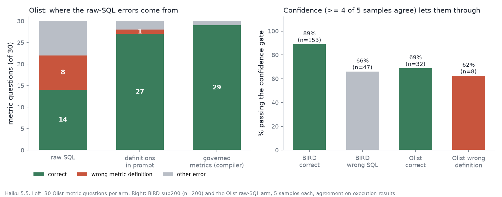
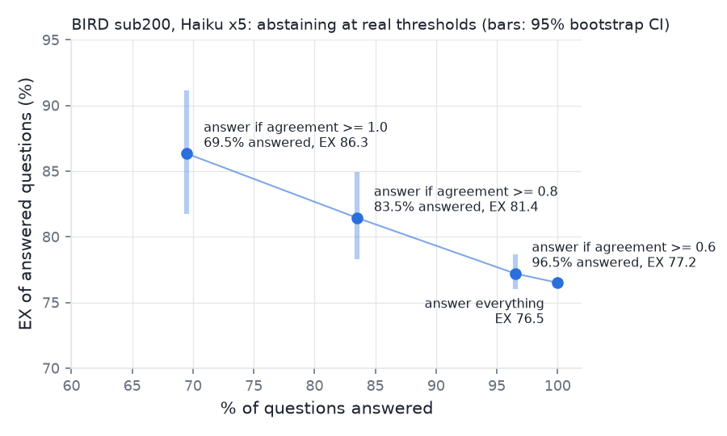

# Confidence catches SQL mistakes, not definition mistakes

[](https://github.com/TonyLee-99/analytics-agent/actions/workflows/ci.yml)
 

| | |
|---|---|
| **Problem** | Text-to-SQL assistants let anyone ask the warehouse a question, but a confidently wrong number in an exec deck is worse than no answer. The hard part is knowing when to trust the answer. |
| **What I built** | An analytics agent (retrieve → plan → generate → validate → execute → self-correct) with read-only SQL guardrails, PII pseudonymization and resource limits; self-consistency confidence with abstention; a governed metric layer and SQL compiler; an evaluation harness on the BIRD Mini-Dev benchmark; a red-team suite; a prompt regression gate; FastAPI and MCP serving. |
| **Key results** | Execution accuracy 62.6% → 73.2% on 500 BIRD questions (paired McNemar p < 0.001). Business-metric questions 14/30 → 27/30 with governed definitions, 29/30 when the metric is compiled. 86.3% accuracy at 69.5% coverage when answering only confident questions. 64/64 attacks blocked with 0 false positives on 550 valid queries. |
| **Stack** | Python, SQL (SQLite, DuckDB), sqlglot, Claude Haiku / Sonnet, FastAPI, MCP, pytest, GitHub Actions |

A text-to-SQL analytics agent ("ask your data warehouse") with a governed metric layer, evaluated for
one question: **when can you trust its number?**

- **Definition errors look like confident answers.** On 30 business-metric questions over the Olist
  warehouse, the raw-SQL agent silently used a *non-governed* definition on 8/30: GMV with freight,
  canceled orders counted, AOV from payments. Its own confidence signal (agreement of 5 samples on the
  result) passed 5 of 8 of those wrong answers at a ≥4/5 gate.
- **Definitions fix it; a compiler makes it structural.** Putting the governed definitions in the
  prompt takes metric questions from 14/30 to 27/30 (p=0.001). Compiling governed metrics to SQL
  gives 29/30 with zero drift. Compiler vs prompt is not significant at this n (p=0.5).
- **Confidence does catch SQL errors.** On BIRD, answering only when all 5 samples agree covers
  69.5% of questions at 86.3% EX, against 76.5% when answering everything (gain +5.2 to +14.6 pp,
  95% bootstrap CI).



**What did not work** (pre-registered criteria, `docs/ACCEPTANCE.md`):
- The confidence score ranks right vs wrong with AUROC 0.69 (CI 0.61–0.77): *inconclusive* against
  the 0.70 target.
- The agent asks a clarifying question on only 60% of genuinely ambiguous questions (target 70%).
- The Haiku→Sonnet router misses its accuracy target.
- Self-correction is not significant run-vs-run.
- Red-teaming also found three security holes after the first version shipped (§4).

## 1. Business definitions: raw SQL vs a governed metric layer (Olist, Haiku 5.5)
The same 50 PM-style questions, the same model, and 2 self-correction rounds in every arm.
30 questions depend on a governed metric such as GMV, AOV or on-time rate; 20 do not.

| Arm | Metric questions correct | Wrong-definition answers | All 50 | Paired test |
|---|---|---|---|---|
| raw SQL (schema + column docs) | 14/30 | 8/30 | 64.0% | |
| + governed definitions in the prompt | 27/30 | 1/30 | **90.0%** | vs raw: +14/−1, p=0.001 |
| governed metrics → compiler writes the SQL | 29/30 | 0/30 | 80.0% | vs prompt: +2/−0, p=0.5 |
| hybrid: compiler for metric questions, prompt arm for the rest (*post hoc*) | 29/30 | 0/30 | 94.0% | vs prompt: +2/−0, p=0.5 |

**Caveats.**
- The definitions, the gold SQL and the compiler were all written for this repo. The raw arm is scored against
  conventions it was never shown; that is the business problem, but it makes 46.7% a "didn't guess
  our conventions" number, not a SQL-skill number.
- n=30 metric questions.
- The compiler arm's weak non-metric score (55%) is its fallback prompt, which over-applied metric
  filters. The hybrid was designed after reading those failures.

Details: `docs/semantic_layer_experiment.md`. Numbers: `results/stats.json` (`semantic`).

## 2. Knowing when not to answer (BIRD sub200, Haiku, 5 samples)
| Policy | Answered | EX of answered |
|---|---|---|
| answer everything (vote of 5) | 100% | 76.5% |
| answer if ≥ 4 of 5 agree | 83.5% | 81.4% |
| answer if all 5 agree | 69.5% | 86.3% |



- **Agreement is a coarse score.** It takes 5 values, and 139 of 200 answers are unanimous, so EX at
  an arbitrary coverage such as "80%" depends on how ties are broken. That is why only the achievable
  thresholds are reported.
- **Routing to Sonnet when Haiku is unsure** (explicit price sheet, no prompt caching):
  - escalating at agreement < 0.8, the pre-registered threshold, gives 82.0% EX at 53% of
    Sonnet-only cost;
  - escalating unless unanimous gives 84.5% at 67% of the cost;
  - Sonnet alone gives 86.0%;
  - an oracle that escalates exactly Haiku's wrong answers would reach 91.5%.
- **Learned policy.** A router learned with nested CV, with an explicit cost per wrong answer, does
  not beat these simple rules.
  - At $1 per wrong answer it reaches 85.3% EX, about the same expected cost as always using Sonnet.
  - Its out-of-fold AUROC is 0.65, below agreement alone.
  - The bottleneck is the selection signal: some sample among the 5 is correct 87.4% of the time.
  - Source: `results/learned_router.json`.
- **Serving.** The API returns this same confidence. `route` is one of answered, needs_review,
  escalated, clarify or failed, and the review threshold is unanimity (`serving/service.py`).
- **Ambiguity.** On 20 curated ambiguous questions, the raw agent asks back 60% of the time and the
  metric-layer agent only 35%: it answers with the governed default instead. There were 0 false
  clarifications on 20 clear controls.

## 3. BIRD Mini-Dev benchmark (2026 release, 500 questions, SQLite)
| Haiku 5.5 | EX, all 500 | EX, excluding the 20 prompt-dev questions |
|---|---|---|
| (a) BIRD's fixed baseline prompt, zero-shot | 62.6% | 63.1 |
| (d) our prompt + retrieved examples + self-correction | 73.2% | 72.9 |

- **Sanity check, not a reproduction.**
  - The dataset card reports 59.60% for Haiku 5.5 with the fixed prompt
    (`eval_sets/provenance/`, revision `5b256b5`, same data files as ours).
  - Our run deviates in three ways: we add a one-line system prompt, the CLI's default temperature
    applies instead of greedy decoding, and we use our own SQL extraction.
  - +3.0 pp is within the ±3.2 pp noise of a single 500-question run.
- **Noise floor.** Two independent draws of the same prompt disagree on 13.5% of questions. A
  run-vs-run delta therefore needs to exceed about ±3.2 pp on 500 questions, or ±5.1 pp on the
  200-question subset, to mean anything.
- **The subset is easier by chance.** The baseline scores 69.5 on sub200 vs 58.0 on the other 300
  (z = 2.7). Use the subset for paired comparisons only.
- **What actually helped** (paired tests on the same questions; `results/ablations.md`):
  - the plan-first prompt: +7.0 pp on sub200, p = 0.08;
  - retrieved examples, only when a near-template exists: no effect on the 391 questions whose
    closest example is dissimilar (SQL Jaccard < 0.5); +10/−2 on the 74 near-templates;
  - self-correction, fixed 9 of 14 broken first drafts: exactly +1.8 pp within one run;
  - Sonnet: +11.5 pp.
- **What did not help.**
  - Schema retrieval *hurt* slightly (76.5 → 72.0, p = 0.12), because BIRD databases have only 3–13
    tables. Recall@10 in an 84-table pooled index is 0.946 (`results/retrieval_recall.json`).
  - The 5-sample vote adds +1.0 pp over its own first sample.
- **Robustness.** Every comparison above was re-scored four ways (official set equality, multiset,
  ordered, float tolerance) and under simulated label noise drawn from a 70-failure audit.
  - No conclusion changes with the metric: same signs, same significance.
  - Under label noise, the three significant results stay significant in 88–100% of simulated
    draws. The least robust is (a)→(b), at 88% under independent noise.
  - Details: `results/robustness.json`, `docs/error_analysis.md`.

## 4. Safety (`docs/security.md`)
The defence has an AST validator, read-only connections with an SQLite authorizer and DuckDB config
lock, masked materialized tables, and time/row/byte limits. Each layer is tested with the layers above
it switched off. Five holes were found and fixed:
- two in v1's own bypass test: SQLite `ATTACH` creating files, and raw PII readable behind masking views;
- three in external review:
  - md5 zip tokens a single SELECT inverted for all 99,441 customers; now keyed HMAC;
  - an allowlist bypass by naming a CTE `sqlite_master`; now scope-aware resolution;
  - unbounded-memory queries; now byte and size limits.

All 64/64 red-team attacks are now blocked, with 0/550 false positives on gold queries and 0 of the
agent's previously correct recorded queries rejected.

## Reproduce
```bash
make setup               # Python 3.12, pinned deps (uv.lock)
make unpack              # restore the recorded runs + LLM response cache (committed, compressed)
make reproduce-results   # rebuild results/*.json and charts with zero model calls; fails on any cache miss
make data verify-data    # download BIRD + Olist and build the warehouse (needed for re-executing SQL)
make test lint           # unit tests; DB-dependent tests skip without `make data`
make eval-small          # 20 live questions (Haiku via the Claude Code CLI)
```
- **Data:** [BIRD Mini-Dev](https://huggingface.co/datasets/birdsql/bird_mini_dev) (CC BY-SA 4.0) and [Olist](https://www.kaggle.com/datasets/olistbr/brazilian-ecommerce) (CC BY-NC-SA 4.0, 99,441 orders, row counts verified). The Olist question sets are in `eval_sets/`.
- **CI:** a workflow is included (`.github/workflows/ci.yml`: lint, tests, regression gate on recorded responses) runs on every push.
- **Regression gate:** a prompt change fails if it loses ≥5 more of 30 frozen questions than it gains. False-alarm rate 2.1%; it flags the recorded degraded prompt; it catches a true −5 pp regression only 10% of the time at n=30 (`tests/regression/gate.json`).

## Cost
3,397 Claude calls, $10.84 at API list price as reported by the CLI (`total_cost_usd`), all evaluation included.

## Limitations
- BIRD schemas are tiny next to a warehouse; the 84-table pooled index is only a proxy (no column pruning, no LLM re-ranker).
- One draw per configuration at the CLI's default temperature, so single-run deltas carry the noise above.
- 10 of 200 self-consistency prompts predate a determinism fix and do not replay byte-identically; reported numbers come from the recorded run files.
- The Olist question sets, definitions and gold SQL were written for this repo (every query executed); the ambiguity set has n=20.
- Latency includes CLI process start-up, so it is not a headline. Production mapping: `docs/production_readiness.md`.
