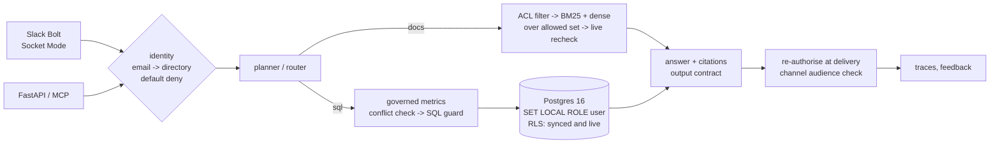

# analytics-agent v2: a permission-aware Slack copilot for City of Chicago 311

[](https://github.com/TonyLee-99/analytics-agent/actions/workflows/ci.yml)
  

**On questions written blind by another model it answers 67% correctly (strict SQL only 42%); 0 leaks in a 60-attack red team, after an independent review found and we fixed two delivery leaks the red team had missed.**

| | |
|---|---|
| **Problem** | Department analysts ask Slack for city documents and 311 numbers. Rows and documents are restricted by department, people change teams constantly, and two departments define "time to close" differently. |
| **Built** | Postgres 16 with per-user roles and row-level security (4,033,015 real 311 requests), 157 real City documents with ACLs checked before ranking and rechecked live, a governed metric layer that asks when a definition is ambiguous, answers with span citations re-authorised at delivery, Slack bot (live, Socket Mode), MCP and HTTP, traces, offline CI eval gate. |
| **Measured** | Blind questions: 67% (60 codex-blind) and 67% (15-question blind holdout). All 135 incl. 60 dev questions: 81%. Red team 0/60 leaks; the same oracle catches 8/10 leaks with defences off. Revocation-lag window: 0 vs 15/15 leaks with/without recheck. |

| Correct answers (`results/v2/eval.json`) | copilot | docs-only RAG | v1 SQL agent |
|---|---|---|---|
| codex-blind (60) | **67%** (strict SQL 42%) | 30% | 25% |
| codex-blind holdout, written after the fixes (15) | **67%** | 33% | 20% |
| all 135, incl. 60 author dev questions (98%) | 81% | 31% | 25% |

**Simulated vs real.** Real: the data, the documents, every model output and number, and a live Slack workspace
(Socket Mode) with one real user so far, the owner ([pilot notes](docs/DISCOVERY.md#real-pilot-notes); his first
session found three delivery bugs, [INCIDENTS I-8](docs/INCIDENTS.md)). Simulated: the org chart and who may see
which document (`config/`), metric-definition owners, the discovery interview. Demo page (built from recorded runs): https://tonylee-99.github.io/analytics-agent/

## More
- Results, sample sizes and error analysis: [docs/EVAL.md](docs/EVAL.md); criteria and PASS/FAIL: [docs/ACCEPTANCE.md](docs/ACCEPTANCE.md)
- Permission tests: red team 0/40 in round 1 and 0/60 after the fixes (holdout 0/20); router 99%, recall@5 100%;
  asks back on 100% of ambiguous metric questions and 0% when the question already states the definition;
  judge vs a second grader on 30 answers stratified by verdict: kappa 0.5 (0.609 correct-vs-not); the disagreements
  are mostly the judge marking answers "partially correct" that the second grader accepts, so the judge is the stricter one.
- Design and the review that changed it: [docs/DESIGN.md](docs/DESIGN.md); decisions: [docs/decisions/](docs/decisions/);
  incidents with a postmortem: [docs/INCIDENTS.md](docs/INCIDENTS.md); operating it: [docs/RUNBOOK.md](docs/RUNBOOK.md),
  [docs/ROLLOUT.md](docs/ROLLOUT.md); [PRD](docs/PRD.md); [feedback to product](docs/FEEDBACK_TO_PRODUCT.md)
- v1 (governed text-to-SQL on BIRD and Olist, unchanged): [docs/V1.md](docs/V1.md)

## Architecture


## Run it
```bash
make init                  # pinned deps + committed replay caches
make pg-start pg-load      # local Postgres 16 + the 311 window + RLS (needs a built chicago-311-warehouse; AA_311_SOURCE)
make check                 # lint, tests (permission tests on real Postgres), eval gate; no model calls
```
Live (Claude Haiku 5.5 through the Claude Code CLI): `make eval-v2 N=all`, `make redteam-v2`, `make lag-experiment`;
Slack: `make slack-live` (tokens from the keychain; RUNBOOK "Going live on Slack").

## Limits
- The author-written 60 questions were the development set (98%); judge the system by the blind 67%.
- Blind SQL misses are mostly shape (right figure without the requested helper columns, other row breakdown).
- One real user so far; department access in the pilot is the Simulated mapping.
- From demo to production: IdP/SCIM instead of `config/org.yaml`, a real document change feed, managed Postgres
  with TLS and a secret store, sync-lag SLO and leak alerts (RUNBOOK, ROLLOUT).
